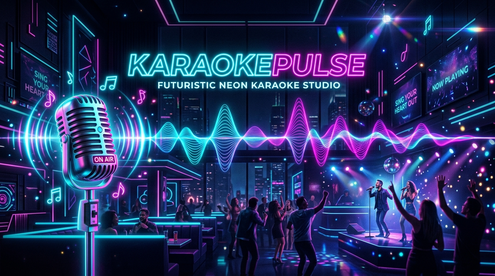

<div align="center">



# 🎤 KaraokePulse — YouTube Karaoke Studio

### *Turn Any YouTube Song into a Live Karaoke Experience with Synced Lyrics, Dual-Stem Vocal Removal, Live Mic Reverb & Pitch Detection*

[](https://lin4cre.github.io/karaoke-pulse/)
[](https://github.com/LIN4CRE/karaoke-pulse)
[](Dockerfile)
[](https://nodejs.org/)
[](https://ffmpeg.org/)
[](LICENSE)

---

[**🌐 Live Studio**](https://lin4cre.github.io/karaoke-pulse/) &bull; [**🌟 Features**](#-features) &bull; [**🐳 Docker Quickstart**](#-docker-quickstart-recommended) &bull; [**🚀 Local Quickstart**](#-local-installation) &bull; [**☁️ 1-Click Cloud Deploy**](#%EF%B8%8F-1-click-cloud-deploy) &bull; [**🎹 Hotkeys**](#-keyboard-shortcuts)

</div>

---

## 🌟 Features

### 1. 🌟 Curated "Top Hits" & "Free Hits" (100% Synced Lyrics Guaranteed)
Never guess whether a song has lyrics. Includes 40+ pre-verified crowd favorites with instant playback:
- 🆓 **Free Source & Royalty-Free Hits**: *On & On* (Cartoon ft. Daniel Levi - 500M views), *Heroes Tonight* (Janji - 350M views), *Monody* (TheFatRat ft. Laura Brehm - 250M views), *Fly Away* (TheFatRat ft. Anjulie), *Wellerman (Sea Shanty)* (Nathan Evans), *House of the Rising Sun* (The Animals), *Bella Ciao* (Manu Pilas / Money Heist), *When the Saints Go Marching In* (Louis Armstrong), *Drunken Sailor* (The Irish Rovers).
- 🎸 **Rock Anthems**: *Bohemian Rhapsody* (Queen), *Don't Stop Believin'* (Journey), *Livin' on a Prayer* (Bon Jovi), *Sweet Child O' Mine* (Guns N' Roses), *Hotel California* (Eagles), *Wonderwall* (Oasis), *Mr. Brightside* (The Killers), *In the End* (Linkin Park).
- 🎤 **Pop Legends**: *Cruel Summer* (Taylor Swift), *Rolling in the Deep* (Adele), *As It Was* (Harry Styles), *Flowers* (Miley Cyrus), *Blinding Lights* (The Weeknd), *Shape of You* (Ed Sheeran), *Bad Romance* (Lady Gaga), *Uptown Funk* (Bruno Mars).
- 🌟 **Classics & Crooners**: *Fly Me to the Moon* (Frank Sinatra), *My Way* (Frank Sinatra), *Can't Help Falling in Love* (Elvis Presley), *Let It Be* (The Beatles), *Hey Jude* (The Beatles), *Stand By Me* (Ben E. King), *Imagine* (John Lennon).
- 💃 **80s & 90s Party**: *I Wanna Dance with Somebody* (Whitney Houston), *Never Gonna Give You Up* (Rick Astley), *Take On Me* (a-ha), *Dancing Queen* (ABBA), *I Want It That Way* (Backstreet Boys), *Wannabe* (Spice Girls), *Billie Jean* (Michael Jackson).

### 2. 🎛️ Dual-Stem Multiband Vocal Reducer
- Unlike crude phase-cancellation tools that destroy bass and kick drums, KaraokePulse uses a **frequency-split filtergraph**:
  - `0 - 160 Hz`: Low-end sub-bass, 808s, and kick drums remain stereo and 100% punchy.
  - `160 - 20,000 Hz`: Center-channel vocals are attenuated while stereo instruments, guitars, synths, and reverbs remain wide.
- **Interactive Vocal Crossfader**: Seamlessly blend between `0%` (Pure Karaoke), `25%` (Guide Vocals), `50%` (Half Split), and `100%` (Original Track).

### 3. ✨ Animated Karaoke Lyrics Engine
- **Progressive Character / Word Fill**: Active lyric line fills with glowing neon in real-time as the line is sung.
- **Bouncing Ball Pulse**: Rides across the active words with bouncing animation.
- **Intro Countdown**: An arcade-style `3... 2... 1...` countdown banner appears before singing begins.
- **Seek-on-Click**: Click any lyric line to jump playback directly to that timestamp.
- **Sync Offset Micro-Tuner**: Fast buttons (`-0.5s` to `+0.5s`) for micro-adjusting lyrics sync on the fly.
- **Automatic Fallback to YouTube Captions**: If a track isn't on LRCLIB, YouTube's official captions are extracted and converted to synced LRC format.

### 4. 🎙️ Live Microphone, Voice FX & Pitch Ribbon
- Connect your microphone with one click.
- **Voice FX Presets**: Switch instantly between *Studio Reverb*, *Stadium Arena*, *Pop Slapback Echo*, *Vintage Radio*, and *Clean Dry*.
- **Autocorrelation Pitch Detector & Pitch Ribbon**: Identifies the musical note you are singing (e.g. `C4`, `G4`) with a glowing real-time Pitch Ribbon gliding between Low and High vocal registers.

### 5. 🏆 SingStar Performance Scoring & Combo System
- **Real-Time Singing Score**: Earn points and build up hype streaks (up to 20x multiplier!) as you sing into the mic in sync with the lyrics.
- **Star Rating**: Climb from 1 to 5 stars in real time.
- **Vocal Performance Summary Modal**: When a song ends, your performance is graded (**S, A, B, C**) with max streak, singing energy %, stars, and celebratory confetti!

### 6. 📋 Party "Up Next" Queue System
- Line up songs seamlessly for parties. Every track card has a **"+ Queue"** button.
- View and manage upcoming songs in the **Up Next** tab.
- Automatically advances to the next track when a song finishes!

### 7. 🎉 Party Soundboard & Confetti Physics
- **👏 Cheer & Confetti**: Crowd applause with a festive particle confetti shower.
- **📢 Airhorn**: Classic 3-blast stadium dancehall hype horn.
- **🥁 Drumroll**: Accelerating snare drum crescendo into a resonant cymbal hit.
- **✨ Sparkle**: Pentatonic glockenspiel chime arpeggio.

### 8. 🔴 Performance Take Recorder
- Record your voice mixed together with the karaoke instrumental track.
- Preview and download your recorded take (`.webm`).

### 9. 🎨 Themes, Visualizers & TV Cinema Mode
- **4 Aesthetic Neon Themes**: *Cyberpunk Neon*, *Electric Sunset*, *Aurora Borealis*, *Midnight Velvet*.
- **3 Visualizer Modes**: *Cyber Bars* 📊, *Neon Oscilloscope Wave* 〰️, and *Radial Starburst* 💥.
- **📺 Big Stage TV Cinema Mode**: Maximizes the lyrics screen for living room TVs and party projectors.

---

## 🐳 Docker Quickstart (Recommended)

Run everything (Node.js, FFmpeg, and yt-dlp) inside an isolated container with zero system dependencies:

```bash
# Clone the repository
git clone https://github.com/LIN4CRE/karaoke-pulse.git
cd karaoke-pulse

# Run with Docker Compose
docker compose up -d
```

Open [http://localhost:3000](http://localhost:3000) in your browser!

---

## 🚀 Local Installation

### Prerequisites
- [Node.js](https://nodejs.org/) (v18+)
- [FFmpeg](https://ffmpeg.org/) installed in system PATH
- [yt-dlp](https://github.com/yt-dlp/yt-dlp) installed in system PATH

```bash
# 1. Clone repository
git clone https://github.com/LIN4CRE/karaoke-pulse.git
cd karaoke-pulse

# 2. Install dependencies
npm install

# 3. Start KaraokePulse Studio
npm start
```

#### On Windows:
Double-click `start-karaoke.bat` to launch automatically and open your default browser.

#### On Linux / macOS:
```bash
chmod +x start.sh
./start.sh
```

---

## ☁️ 1-Click Cloud Deploy

Deploy your own live karaoke instance online:

[](https://render.com/deploy)

1. Connect this GitHub repo to **Render**, **Railway**, or **Fly.io**.
2. Select **Docker** environment (uses the included [`Dockerfile`](Dockerfile)).
3. Done! Your instance is live on your custom domain or sub-domain.

---

## 🎹 Keyboard Shortcuts

| Shortcut | Action |
| :--- | :--- |
| `Spacebar` | Play / Pause |
| `Left Arrow` | Rewind 5 seconds |
| `Right Arrow` | Fast forward 5 seconds |
| `Click on any Lyric` | Instantly jump song playback to that line |
| `⛶ Fullscreen` | Full-screen Party Stage mode |

---

## 🛠️ Architecture & Tech Stack

```
karaoke-pulse/
├── public/
│   ├── index.html       # Cyberpunk Karaoke UI
│   ├── style.css        # Responsive CSS3 with 4 themes & glowing animations
│   └── app.js           # Web Audio API engine, Pitch Detector & Lyric Sync
├── media/               # Cached audio stems and metadata
├── data/
│   ├── catalog.json     # 40+ Curated Top Hits & Free Hits with verified lyrics
│   └── library.json     # Local user library
├── assets/
│   └── banner.png       # Cinematic Neon Studio Banner
├── server.js            # Node.js Express server + yt-dlp & FFmpeg pipeline
├── Dockerfile           # Production Docker container with Node, FFmpeg, yt-dlp
├── docker-compose.yml   # 1-command container orchestration
├── render.yaml          # 1-click cloud deploy configuration
├── start-karaoke.bat    # 1-Click Windows Launcher
├── start.sh             # 1-Click Linux / macOS Launcher
└── package.json
```

---

## 📄 License

MIT License &copy; 2026 [David Linacre (LIN4CRE)](https://github.com/LIN4CRE).
